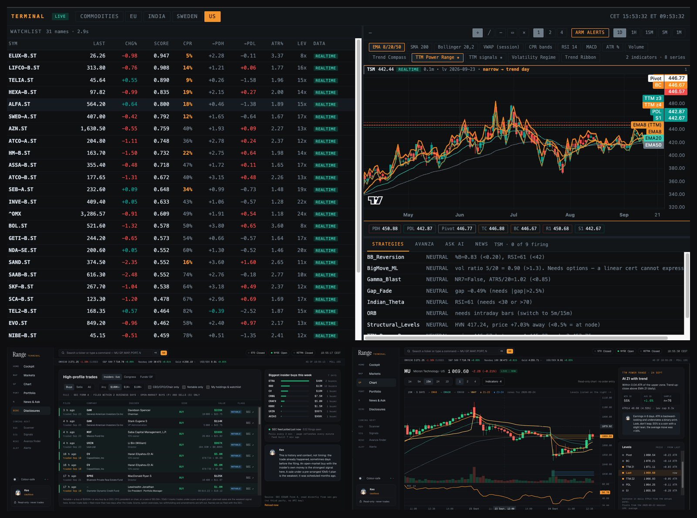

# Range

**A personal trading terminal. Read-only by design.**

Range is a local, browser-based terminal built around one idea: trade the day's
range, not the noise. It pairs a Next.js front end with a Python (FastAPI)
backend that does all the maths: range-based setups, zone-aware charts,
portfolio insights, congressional and insider disclosures, and **Kes**, an AI
agent that explains what is moving but never places a trade.

> **Not investment advice.** Range is a research tool for personal use. It can
> read a brokerage account, but it has no code path that places, modifies or
> cancels an order.



<p align="center">
  
  
  
  
</p>

---

## Pages

Each page does one job, like a function screen on a traditional terminal. Type
a ticker and a code in the command bar (for example `MU GP`) to jump straight
to it.

| Code | Page | What it does |
|---|---|---|
| `HOME` | **Cockpit** | Today's TTM Power Range setups, ranked by how similar setups have played out historically, with a "before you enter" checklist (target, stop, leverage cap, earnings). |
| `GP` | **Chart** | Candles with today's zones shaded across the current session only. Every level (pivots, prior-day high/low, zones) sits in a price-sorted ladder beside the chart, measured in ATR, so no labels pile up. |
| `PORT` | **Portfolio** | Holdings, allocation, currency exposure, performance by period and an on-demand brief. |
| `N` | **News & Ask Kes** | News filtered to what you hold or watch, tagged when a headline explains a move, plus a chat with Kes. |
| `DISC` | **Disclosures** | Congressional (STOCK Act), insider (Form 4) and fund (13F) filings, with the filing lag shown so old disclosures are never read as fresh signals. |

A landing page at `/` introduces the product.

## Principles

- **Read-only, always.** Brokerage access goes through a fixed allowlist of four
  read endpoints. There are no order buttons.
- **No number without its age.** Every panel shows whether its data is live,
  delayed, closed or stale.
- **Computed, not generated.** Figures come from data. The AI agent only
  explains them and says "I don't know" when data is stale.
- **Discipline over prediction.** The Cockpit asks for a target and a stop
  before any entry, and caps leverage at `100 / (3.5 × ATR%)`, so that an
  ordinary day's move can't knock the position out.

## Architecture

```
Browser ──► Next.js (web/)  ── same-origin /api/* proxy ──►  FastAPI (terminal/)
            landing + 5 pages                                ├─ feeds: yfinance, optional broker, spot
            TypeScript, SWR,                                 ├─ setups: TTM Power Range zones + base rates
            lightweight-charts                               ├─ portfolio: read-only allowlisted client
                                                             ├─ disclosures: Alpha Vantage (cached daily)
                                                             └─ Kes: deterministic briefing + claude -p
```

The browser only calls its own origin. Next.js forwards `/api/*` to the
backend (`API_PROXY_TARGET`), so no CORS setup is needed, and a hosted front end
can point at a hosted backend without code changes.

## Quick start

Requirements: Python 3.13, Node.js 20+, npm.

```bash
# 1. Backend
pip install -r requirements.txt
cp .env.example .env                  # optional: broker + data API keys, see below
python3.13 -m terminal.app            # http://127.0.0.1:8777

# 2. Front end (second terminal)
cd web
npm install
npm run dev                           # http://localhost:3000
```

Open http://localhost:3000. Without any credentials, market data, setups,
charts and news all work on public data. The portfolio and disclosures pages
explain what they need.

The legacy single-page UI is still served by the backend at
http://127.0.0.1:8777.

## Configuration

| Setting | Where | Enables |
|---|---|---|
| `AVANZA_USERNAME`, `AVANZA_PASSWORD`, `AVANZA_TOTP_SECRET` | `.env` | Real-time Nordic quotes and the read-only portfolio (optional). TOTP setup: `python3.13 -m terminal.avanza_setup`. |
| `ALPHAVANTAGE_API_KEY` | `.env` | The Disclosures page (free key at alphavantage.co). Responses are cached daily to respect the free tier. |
| `API_PROXY_TARGET` | environment of `npm run dev` / `npm start` | Backend URL for the front end (default `http://127.0.0.1:8777`). |
| `profile.local.md` | repo root (copy from `profile.example.md`) | Personal context for Kes (optional). |
| `alerts_config.json` | repo root (copy from the example) | Push alerts via ntfy (optional). |

Everything personal (`.env`, `profile.local.md`, `alerts_config.json`,
`portfolio_mcp/ticker_map.json`, `data/`) is gitignored. Example files ship in
their place.

## Mock mode

To work on the front end without broker credentials or an API key, serve
synthetic fixtures for the portfolio and disclosures endpoints:

```bash
python3.13 -m terminal.app --port 8782            # real backend for everything else
cd web && npm run mock:api                        # fixtures on :8790, proxies the rest to :8782
API_PROXY_TARGET=http://127.0.0.1:8790 npm run dev
```

All fixture data is invented and clearly labelled as such.

## Tests

```bash
python3.13 -m pytest -q                            # backend: fakes only, no network, no logins
cd web && npx tsc --noEmit && npm run lint && npm run build
```

## Safety notes

- **Read-only brokerage access.** `portfolio_mcp/avanza_readonly.py` can only
  send requests on an immutable allowlist. Account numbers are replaced with
  aliases (`ISK`, `AF`, …) before any data leaves the process.
- **Login protection.** Broker logins are rate-limited upstream, so after a
  failed login the backend waits before trying again. The cool-down is 30
  minutes after a rejected credential, and it never retries in a loop.
- **Sandboxed agent.** Kes runs the Claude CLI with no tools and no MCP servers,
  because its prompt includes third-party headlines.
- **Local only, for now.** The backend binds to `127.0.0.1` and the API has no
  authentication. Don't expose it to a network until an auth layer is in place.

## Project layout

| Path | Contents |
|---|---|
| `web/` | Next.js app: landing page, terminal pages, shared components (`src/components`), typed API client (`src/lib/api.ts`) |
| `terminal/app.py` | FastAPI app, feeds wiring, legacy UI |
| `terminal/api_v2.py` | JSON API used by the front end (documented in `docs/API.md`) |
| `terminal/feeds/` | Market data: yfinance, broker feed, spot prices, streaming, routing |
| `terminal/indicators.py` | Server-side indicators, including TTM Power Range |
| `terminal/kes.py`, `ai.py` | Kes briefing and the AI chat |
| `terminal/disclosures.py`, `plans.py` | Filings client, local trade-plan log |
| `screeners/` | Levels (CPR, pivots, ATR), watchlist scoring, zone panel |
| `portfolio_mcp/` | Read-only portfolio client, also usable as an MCP server |
| `tests/` | Backend unit tests |
| `docs/API.md` | Endpoint reference |

## Disclaimer

This software is provided for research and educational purposes. Nothing in it
is investment advice. Market data can be delayed or wrong, and every figure
shows its source and age for that reason. Leveraged products can lose value
quickly, including through daily-reset decay. The broker integration uses an
unofficial API that may change without notice.
